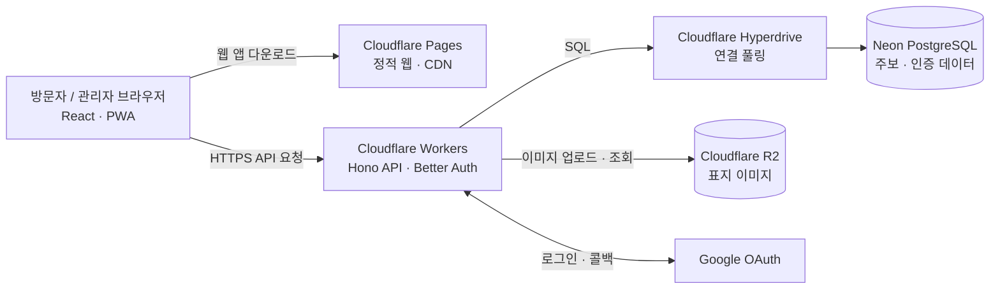
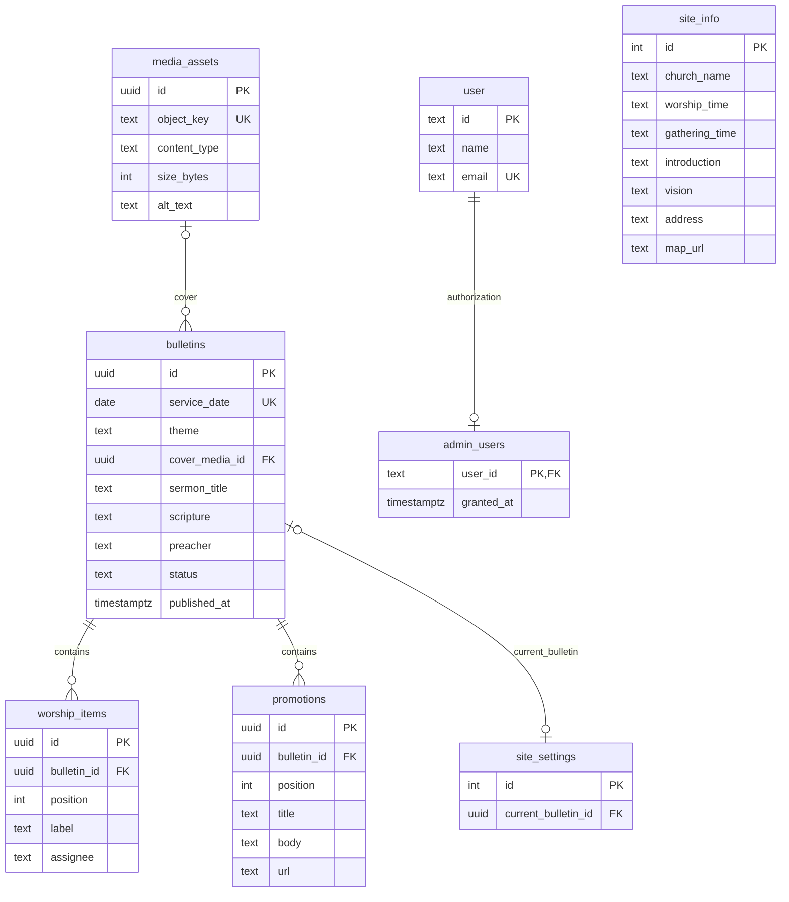

# 선한목자 젊은이교회 모바일 주보

React + Vite 공개·관리자 웹, Hono + Better Auth Workers API, PostgreSQL, Cloudflare R2로 구성한 모바일 주보 프로토타입입니다. 공개 주소 `/`는 현재 발행본을 보여 주고, `/archive`와 `/bulletins/YYYY-MM-DD`에서 지난 발행본을 볼 수 있습니다. 관리자 화면은 `/admin`입니다.

## 구현 범위

- 주보 표지(선택적 이미지), 예배 순서·담당자, 설교, 홍보 카드 0~3개, 고정 교회 안내
- 주보 초안 생성 시 이전 발행본의 **예배 순서명만** 복제
- 저장과 발행 분리, 모바일 미리보기, 발행본 오탈자 수정
- 발행 트랜잭션으로 최신 주보 포인터 변경, 비공개 초안과 관리자 API 권한 검사
- 한 번 온라인에서 연 최신 주보 JSON과 대표 이미지를 저장하는 PWA

행사 신청, 일반 회원 화면, PDF, 알림, 영상 업로드는 기획서의 후속 범위입니다.

## 구조

### 서비스 아키텍처



웹은 Cloudflare Pages에서 정적 파일로 제공하며, 브라우저는 Workers의 Hono API를 호출합니다. API는 Hyperdrive를 통해 PostgreSQL에 연결하고, 주보 표지 이미지 파일은 R2에 저장합니다. 이미지 메타데이터와 주보 데이터는 PostgreSQL에 기록합니다. 인증은 Better Auth와 Google OAuth를 사용합니다.

### 데이터베이스 ERD



`user`는 Better Auth가 생성하는 사용자 테이블을 가리킵니다. `admin_users.user_id`는 애플리케이션에서 `user.id`와 연결해 권한을 검사하지만, `schema.sql`에는 DB 외래키 제약이 선언되어 있지 않습니다. Better Auth의 세션·계정·검증 테이블은 `npx auth migrate`로 별도 생성됩니다. `site_info`와 `site_settings`는 각각 단일 행(`id = 1`)을 유지합니다. 주보 삭제 시 예배 순서와 홍보 항목은 함께 삭제됩니다.

### 무료 플랜 용량 참고

2026-10-25 기준 공식 문서의 대표 무료 한도입니다. 한도와 과금 정책은 바뀔 수 있으므로 실제 배포 전에 각 제공자의 페이지를 다시 확인하세요.

| 서비스 | 무료 포함량 | 이 프로젝트에서의 용도 |
| --- | --- | --- |
| Cloudflare R2 Standard | 저장 10 GB-month/월, Class A 100만 건/월, Class B 1,000만 건/월, 인터넷 송신 무료 | 주보 이미지 파일. 저장량 초과분은 종량 과금 |
| Cloudflare Workers Free | 요청 10만 건/일, CPU 10 ms/호출 | Hono API 및 Pages Functions 호출 한도 |
| Cloudflare Pages | 정적 자산 요청 무제한·무료, 월 빌드 500회 | React 정적 웹 앱 배포 |
| Neon Free | PostgreSQL 저장 1 GB/프로젝트, 프로젝트 100개까지, 컴퓨트 100 CU-hours/프로젝트/월, 네트워크 송신 5 GB/프로젝트/월 | PostgreSQL 데이터베이스. DB 저장 용량과 컴퓨트/송신 한도는 별도 |

Cloudflare R2는 월별 저장 평균(GB-month)을 기준으로 산정하며, 10 GB-month 초과 시 저장 비용이 발생할 수 있습니다. Workers 무료 요청량은 API 호출에 적용되고 Pages 정적 파일 요청과는 별도입니다. Neon의 무료 한도는 공식 [요금 변경 안내](https://neon.com/blog/neon-free-plan-1-gb-per-project)와 [Free plan FAQ](https://neon.com/docs/introduction/plans)에 따릅니다. 그 밖의 Cloudflare 세부 한도는 [R2 가격](https://developers.cloudflare.com/r2/pricing/), [Workers 가격](https://developers.cloudflare.com/workers/platform/pricing/), [Pages 한도](https://developers.cloudflare.com/pages/platform/limits/)를 참고하세요.

## 로컬 구조

```text
apps/web  React + Vite · Cloudflare Workers 정적 자산 또는 Pages
apps/api  Hono + Better Auth · Cloudflare Workers
apps/api/db/schema.sql  서비스 데이터 스키마
```

## 로컬 준비

Node.js 22 이상과 PostgreSQL이 필요합니다.

1. `npm install`
2. PostgreSQL 데이터베이스를 만들고 `DATABASE_URL` 환경 변수를 설정합니다.
3. `apps/api/.dev.vars.example`을 `apps/api/.dev.vars`로, `apps/web/.env.example`을 `apps/web/.env.local`로 복사합니다. API 파일에 Better Auth 비밀값과 Google OAuth 키를 채웁니다. 비밀값은 32자 이상 난수로 생성합니다.
4. Better Auth 인증 테이블을 생성한 뒤 서비스 스키마를 적용합니다.

   ```sh
   cd apps/api
   export DATABASE_URL='postgres://...'
   export BETTER_AUTH_SECRET='...'
   npx auth migrate --config ./auth.config.ts --yes
   psql "$DATABASE_URL" -f db/schema.sql
   ```

5. `CLOUDFLARE_HYPERDRIVE_LOCAL_CONNECTION_STRING_HYPERDRIVE`에 같은 `DATABASE_URL`을 설정합니다. `wrangler.jsonc`의 Hyperdrive `id`는 배포 전 실제 ID로 바꿉니다.
6. `npm run dev:api`와 `npm run dev:web`을 각각 실행합니다. 웹은 `http://localhost:5173`, API는 `http://localhost:8787`입니다.

Google OAuth 리디렉션 URI는 로컬에서 `http://localhost:8787/api/auth/callback/google`, 무료 운영 구성에서 `https://gsmch-youth-bulletin.gsmch-youth-dev.workers.dev/api/auth/callback/google`로 등록합니다. 별도 도메인을 쓰는 경우에는 해당 API 주소를 등록합니다. 관리자 계정으로 한 번 로그인한 뒤 DB 관리자가 해당 계정을 승인합니다.

```sh
cd apps/api
psql "$DATABASE_URL" -v admin_email='관리자 이메일' -f db/grant-admin.sql
```

승인을 취소할 때는 `DELETE FROM admin_users WHERE user_id = ...`를 실행합니다. 관리자 화면에서는 권한을 부여할 수 없습니다.

## CI와 테스트

GitHub Actions는 Pull Request, `main` 브랜치 푸시, 수동 실행에서 Node.js 22로 의존성을 설치하고 타입 검사, 테스트, 웹·API 빌드를 실행합니다. 같은 검증은 로컬에서 다음 명령으로 실행할 수 있습니다.

```sh
npm run ci
```

API 입력 스키마 테스트는 `apps/api/tests`에 추가합니다. 현재 테스트는 날짜, URL, 주보 입력과 교회 안내 검증을 다룹니다. Cloudflare 배포는 계정별 Worker·Pages 프로젝트, Hyperdrive ID, 도메인과 배포 비밀값 설정이 필요하므로 운영 값을 준비한 뒤 배포 자동화를 연결하세요.

## 배포 설정

현재 계정의 무료 구성은 [무료 배포 안내](docs/free-deployment.md)를 따릅니다. `deployment/config.free.example.json`에 확인된 Workers 주소, Hyperdrive ID, R2 버킷 이름이 들어 있습니다. 이 파일을 `deployment/config.free.local.json`으로 복사한 뒤 `npm run prepare:free`와 `npm run build:free`로 배포 설정을 검증합니다. 로컬 설정과 생성된 Wrangler 파일은 Git에 포함되지 않습니다.

나중에 별도 도메인과 Pages를 사용하려면 [운영 배포와 점검](docs/operations.md)에 따라 `deployment/config.example.json`을 채우고 `npm run prepare:production`을 실행합니다.

운영 자격 증명이 없어도 `npm run build`로 웹과 API 배포 산출물을 확인할 수 있습니다. 실제 계정과 기기에서 확인할 항목은 [운영 문서](docs/operations.md)에, 공식 웹사이트에서 찾은 교회 안내 후보는 [교회 안내 검토 자료](docs/site-info-review.md)에 정리했습니다.

## API

공개 API는 `/v1/health`, `/v1/bulletins/current`, `/v1/bulletins`, `/v1/bulletins/:date`입니다. 관리자 API는 `/v1/admin/*`이고 모든 요청에서 Better Auth 세션과 `admin_users`를 검사합니다. 오류는 `{ "code": "...", "message": "..." }` 형태로 반환합니다. `GET /v1/bulletins/current`는 캐시하지 않아 발행 직후 같은 QR 주소에서 새 주보를 읽습니다.

## 참고 문서

- [모바일 주보 기획서](docs/gsmch-youth-bulletin-plan.md)
- [기술 설계 초안](docs/gsmch-youth-bulletin-technical-design-draft.md)
